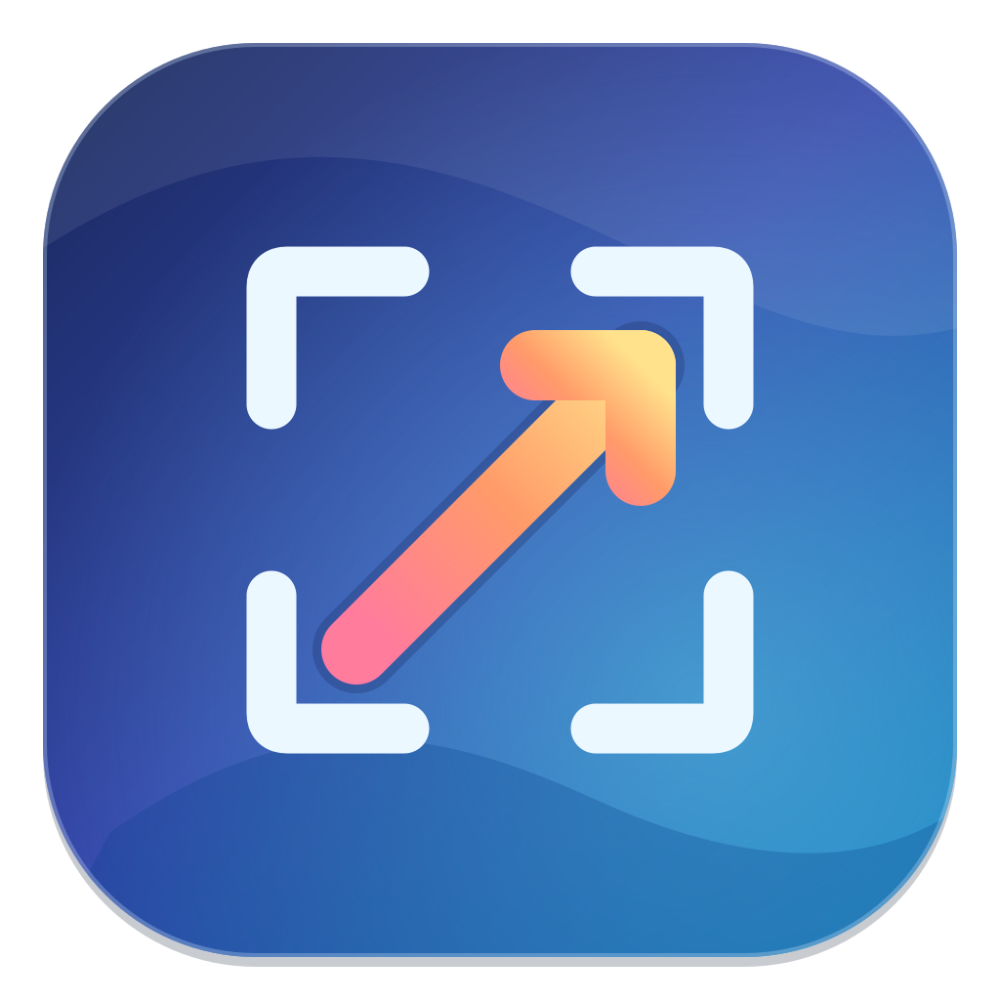

# ScreenMac

**A native macOS screenshot app for capturing a screen region, adding annotations, and copying or saving the result.** Built with Swift, SwiftUI, AppKit, and ScreenCaptureKit.

ScreenMac runs in the menu bar and supports macOS 14 or later on Apple silicon and Intel Macs.

[Русская версия](#screenmac-на-русском)

## Features

- Capture a selected region on the display under the pointer.
- Start capture from the menu bar or with the configurable global shortcut (default: `⌥⌘2`).
- Annotate screenshots with arrows, rectangles, lines, freehand drawing, and text.
- Copy the finished image to the clipboard or save it as PNG.
- Optionally launch at login.

## Download and build

I’m publishing the source code for now. I’m not offering the supplied 1.10 DMG as an installer: its checksum is valid, but I couldn’t verify the app inside it. The app in the accompanying Xcode archive also failed macOS Gatekeeper’s trust check. Before I offer a ready-to-install download, I need to rebuild the app, sign it with an Apple Developer ID certificate, and have Apple notarize it.

For now, you can build ScreenMac yourself with Xcode 15 or later using the instructions below.

## Build from source

1. Install Xcode 15 or later.
2. Open `ScreenMac.xcodeproj` and select the **ScreenMac** scheme and **My Mac** destination.
3. In **Signing & Capabilities**, choose your own development team for local signing.
4. Build and run with `⌘R`.
5. On the first capture, grant ScreenMac permission under **System Settings → Privacy & Security → Screen & System Audio Recording**, then quit and reopen the app if macOS asks.

The app uses bundle identifier `com.anatoliyzyk.ScreenMac`. After building it yourself, macOS treats it as a separate app and may request screen recording permission again.

## Use

ScreenMac stays in the menu bar and does not show in the Dock. Use the camera menu icon to open settings or start a capture. Drag to select a region; press `Esc` to cancel. In the editor, choose an annotation tool and use `⌘C` to copy the result. Saving a PNG is a separate action. Closing the editor discards that capture.

## Notes

- Capture runs on the display where the pointer is when capture starts. A selection cannot cross between displays.
- ScreenCaptureKit captures the selected display when you request a screenshot. macOS controls the screen recording permission.
- Login launch is off by default. For reliable login launch, keep the app in `/Applications`.

## License

No license is provided. The source is public for inspection, but this project does not grant permission to reuse, modify, or redistribute it.

---

## ScreenMac на русском

**Нативное приложение macOS для снимков экрана: выделение области, аннотации, копирование в буфер обмена и сохранение в PNG.** Написано на Swift с использованием SwiftUI, AppKit и ScreenCaptureKit.

Работает в строке меню на macOS 14 и новее, на Apple silicon и Intel.

### Возможности

- Захват области на дисплее, где находится указатель.
- Запуск из меню камеры или настраиваемым глобальным сочетанием клавиш (по умолчанию `⌥⌘2`).
- Аннотации: стрелки, прямоугольники, линии, карандаш и текст.
- Копирование результата в буфер обмена или сохранение в PNG.
- Необязательный запуск при входе в систему.

### Скачать и собрать

Пока я публикую только исходный код. DMG версии 1.10 из архива я не предлагаю как готовый установщик: файл прошёл проверку контрольной суммы, но проверить приложение внутри него мне не удалось. Приложение из Xcode-архива также не прошло проверку доверия Gatekeeper. Чтобы распространять готовый установщик, мне нужно пересобрать приложение, подписать его сертификатом Apple Developer ID и пройти нотариализацию Apple.

Пока вы можете собрать ScreenMac в Xcode 15 или новее: откройте `ScreenMac.xcodeproj`, выберите схему **ScreenMac** и устройство **My Mac**, укажите свою команду для локальной подписи и запустите приложение через `⌘R`.

При первом снимке разрешите запись экрана в **Системные настройки → Конфиденциальность и безопасность → Запись экрана и системного аудио**. При необходимости завершите и снова запустите приложение. Идентификатор приложения — `com.anatoliyzyk.ScreenMac`.

Приложение остаётся в строке меню и не показывает значок в Dock. Закрытие редактора отменяет текущий снимок; для выхода используйте меню камеры. Захват выполняется на дисплее под указателем при запуске; область через границу двух дисплеев выбрать нельзя. Автозапуск выключен по умолчанию.

### Лицензия

Лицензия не предоставляется. Исходный код открыт для просмотра, но повторное использование, изменение и распространение не разрешены.
